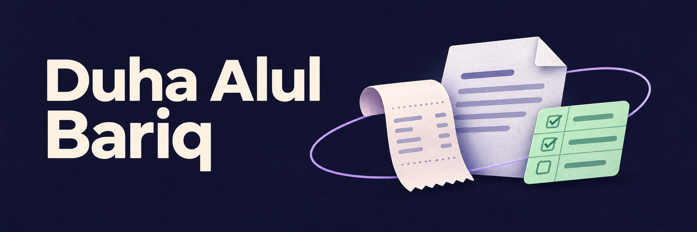

## Halo, saya Duha 👋

Saya mahasiswa yang membangun aplikasi mobile dan web. Saya suka mencari cara untuk mempersingkat pekerjaan sehari-hari, dari membagi tagihan makan sampai merapikan dokumen Word.

**[Coba Format-Guard ↗](https://duhaalul.github.io/Format-Guard/)** · **[Jelajahi repositori ↗](https://github.com/duhaalul?tab=repositories)**

## Proyek pilihan

### 🧾 [BillSwipe](https://github.com/duhaalul/billswipe) · Bagi tagihan dari foto struk

Foto struk, pilih siapa yang memesan tiap item, lalu bagi pajak, biaya layanan, dan diskon secara proporsional. Saya menggunakan bilangan bulat untuk rupiah dan membagikan sisa pembulatan supaya total bagian tetap sama dengan total tagihan.

### 📄 [Format-Guard](https://github.com/duhaalul/Format-Guard) · Rapikan dokumen Word di browser

Periksa margin, font, spasi, dan format paragraf, lalu unduh salinan yang sudah dirapikan. Pemrosesan berjalan di browser sehingga dokumen tetap di perangkat pengguna. **[Coba dengan dokumen contoh ↗](https://duhaalul.github.io/Format-Guard/)**

### ✅ [Sistem Kinerja Pegawai](https://github.com/duhaalul/sistem-kinerja-pegawai) · Kelola tugas dan logbook

Proyek tim untuk mencatat pekerjaan harian dan memudahkan peninjauan oleh pimpinan. Kontribusi saya mencakup logbook, ekspor PDF, dan REST API.

## Skills & tools

**Mobile & integrasi**

Flutter dan Dart untuk aplikasi Android, Supabase untuk autentikasi dan data, serta Firebase Cloud Messaging untuk notifikasi.

**Web & backend**

JavaScript, HTML, dan CSS untuk alat web. Node.js, Express, dan MySQL untuk REST API dan penyimpanan data.

Keputusan teknis di balik proyek

- **BillSwipe** menyimpan pembagian tagihan secara lokal agar alur dasarnya bisa dipakai tanpa akun. Fitur pertemanan dan tagihan online memakai backend.
- **Format-Guard** memakai JSZip untuk membaca dan menulis paket DOCX di browser. Penomoran otomatis bawaan Word masih di luar cakupan.
- **Sistem Kinerja Pegawai** membagi alur kerja berdasarkan peran. Pegawai mengisi logbook dan pimpinan meninjaunya.

